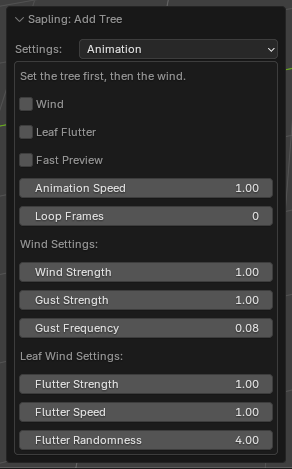

# Animation

The wind animation. Set the tree first, then the wind. [Back to the manual](index.md)

| Setting | Default | Range | What it does |
| --- | --- | --- | --- |
| Wind | off | | The branches sway in the wind. Without a rig, Geometry Nodes move them. With *Armature Rig*, the wind moves the bones. |
| Leaf Flutter | off | | With *Wind*: the leaves flutter. |
| Fast Preview | off | | Faster playback while you work: the branches show as their curves, or with a rig the tree as its bounds and the bones as wire. |
| Animation Speed | 1 | above 0 | The speed of the animation, relative to the frame rate of the scene. |
| Loop Frames | 0 | 0 and more | The animation repeats after this number of frames. 0: no loop. |
| Wind Strength | 1.0 | | How strongly the branches sway. |
| Gust Strength | 1.0 | | How strongly the gusts push the tree toward -Y. |
| Gust Frequency | 0.075 | | How often the gusts come. |
| Flutter Strength | 1.0 | | How far the leaves flutter. |
| Flutter Speed | 1.0 | above 0 | How fast the leaves flutter. |
| Flutter Randomness | 4.0 | | How different the flutter of each leaf is. |

## Notes

- The wind shape of the crown (a tree that a constant wind has formed) is on the [Pruning](pruning.md) page.
- *Leaf Flutter* with a *Flutter Speed* of 0 or less stops the tree with a message.
- Leaves of the *Instance Points* shape do not flutter: a point does not change when it turns about itself.
