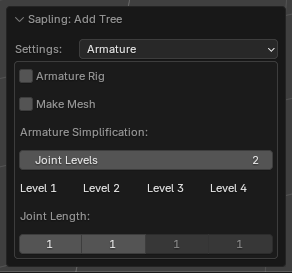

# Armature

The armature rig and the baked mesh. [Back to the manual](index.md)

| Setting | Default | Range | What it does |
| --- | --- | --- | --- |
| Armature Rig | off | | Adds an armature (*treeArm*) whose bones move the branches. With *Wind*, the wind animates the bones. |
| Make Mesh | off | | Bakes the branches into a plain mesh in the tree object, for export. With a rig, the extension weights the mesh to the bones. |
| Joint Levels | 2 | 0 and more | The number of levels that get bones of their own. 1 rigs the trunk, 2 adds its branches. 0 rigs all levels. A deeper level follows the nearest bone below it. |
| Joint Length (per level) | 1 | 1 and more | The number of stem segments that one bone spans. |

## The bones

After generation, the bone collection *Sapling Bones* hides the bones. To show them, click the eye icon of that
collection in *Armature Properties > Bone Collections*. *Fast Preview* on the [Animation](animation.md) page also
shows them.

## The size of the rig

Blender needs more time for each new bone when the rig has more bones, so a large rig takes a long time to build.
The extension warns above 10,000 bones and refuses more than 40,000. Lower *Joint Levels*, or increase *Joint
Length*, to make a smaller rig. Wind without a rig needs no bones.

## Make Mesh

Without *Make Mesh*, the branches are a live Geometry Nodes sweep: the bevel and the resolution stay editable, and an
export with modifiers applied writes them as a mesh. With *Make Mesh*, you cannot change the bevel inputs, *Fast
Preview* shows the bounds, and the playback is heavier because Blender moves every vertex.
