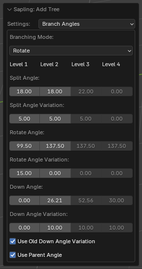
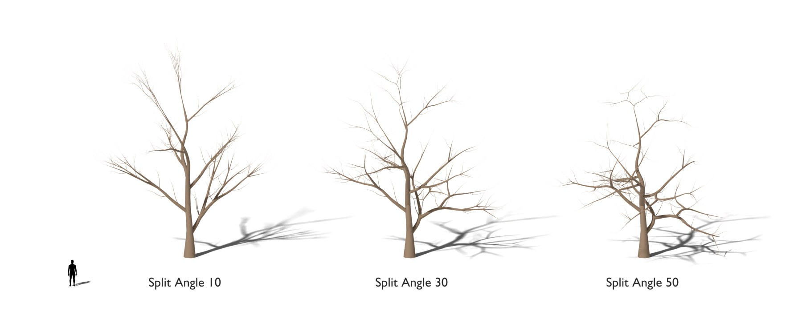
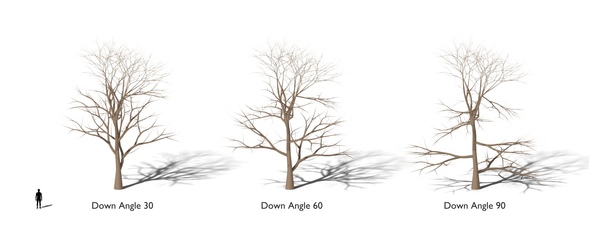

# Branch Angles

The branching mode and the angles of the splits and the branches. [Back to the manual](index.md)

| Setting | Default | Range | What it does |
| --- | --- | --- | --- |
| Branching Mode | Rotate | Rotate, Random, Original | *Rotate* spreads the branches evenly round the tree. *Random* chooses a random point. *Original* turns round each branch. |
| Split Angle (per level) | 0 | | The angle between the parts of a split, in degrees. Needs *Segment Splits* or *Base Splits*. |
| Split Angle Variation (per level) | 0 | | A random change of *Split Angle*. |
| Rotate Angle (per level) | 137.5 | | The angle round its parent from one branch to the next, in degrees. 137.5 gives an even spiral. A negative value puts the branches on alternating sides. |
| Rotate Angle Variation (per level) | 0 | | A random change of *Rotate Angle*. |
| Down Angle (per level) | 90, 60, 45, 45 | | The angle between a new branch and its parent, in degrees. 90 is straight out. |
| Down Angle Variation (per level) | 0, -50, 10, 10 | | A positive value makes the *Down Angle* smaller toward the end of the parent. A negative value changes it at random. |
| Use Old Down Angle Variation | off | | A negative *Down Angle Variation* changes the angle with the height of the branch, not at random, as in the original presets. |
| Use Parent Angle | on | | With *Branching Mode* *Rotate*: the first-level branches turn with a curved trunk. Off: their *Down Angle* is from the vertical. |

## Notes

- *Rotate Angle* with the value -90 on a level gives flat sprays of twigs, as on the Monterey cypress presets: the
  twigs grow to the left and to the right of their parent.
