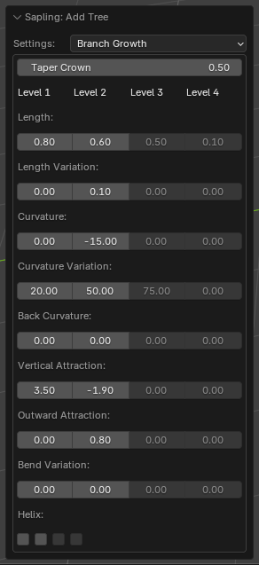
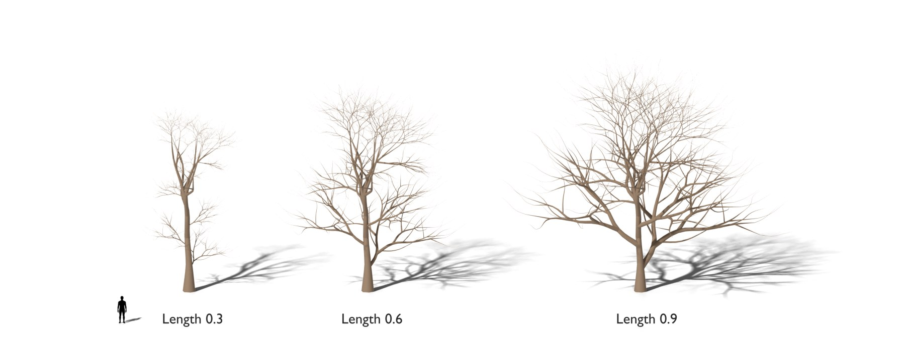
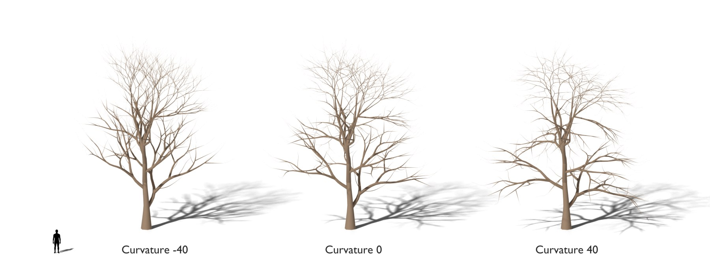
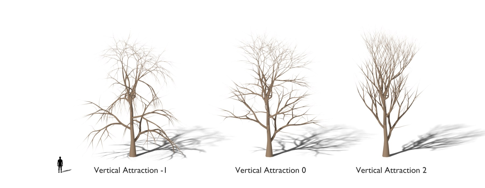
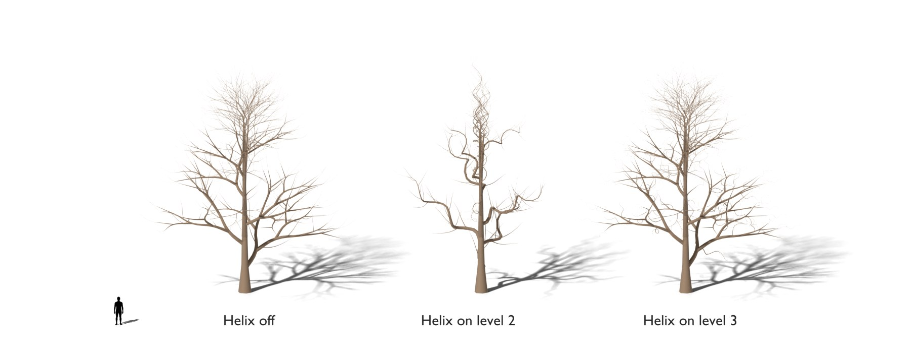

# Branch Growth

The length and the curvature of the branches, and the helix stems. [Back to the manual](index.md)

| Setting | Default | Range | What it does |
| --- | --- | --- | --- |
| Taper Crown | 0 | 0 and more | Makes the splits of the trunk shorter toward the outside of the tree. |
| Length (per level) | 1, 0.3, 0.6, 0.45 | above 0 | The length of a branch of the level, as a part of its parent's length. |
| Length Variation (per level) | 0 | 0 to 1 | A random change of *Length*. |
| Curvature (per level) | 0, -40, -40, 0 | | The angle that a branch of the level turns from its start to its end, in degrees. Negative values turn it down. |
| Curvature Variation (per level) | 20, 50, 75, 0 | | A random change of *Curvature*. With *Helix*, it sets the angle of the helix. |
| Back Curvature (per level) | 0 | | A turn in the other direction in the second half of a branch: an S-shaped branch. |
| Vertical Attraction (per level) | 0 | | Positive values turn the branches of the level up; negative values turn them down. |
| Outward Attraction (per level) | 0 | 0 to 1 | Turns the branches of the level away from the centre of the tree. |
| Bend Variation (per level) | 0 | 0 to 360 | Turns each segment of a branch sideways by a random angle, up to this value divided by the number of segments. The first segment and a segment that splits do not turn. |
| Helix (per level) | off | | The stems of the level grow as helixes, half a turn per segment. *Curvature Variation* sets the helix angle, which must be less than 90 degrees. Helix stems do not split, curve or bend. |

