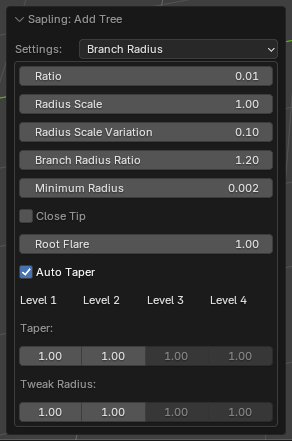
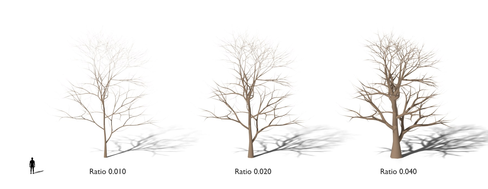

# Branch Radius

The thickness of the trunk and the branches. [Back to the manual](index.md)

| Setting | Default | Range | What it does |
| --- | --- | --- | --- |
| Ratio | 0.015 | 0 and more | The radius of the trunk at its base, as a part of the tree height. |
| Radius Scale | 1.0 | 0 and more | Multiplies the radius of the trunk. |
| Radius Scale Variation | 0.2 | 0 to 1 | A random change of *Radius Scale*. |
| Branch Radius Ratio | 1.2 | 0 and more | How much thinner a branch is than the branch it grows from. Higher values make thinner branches. |
| Minimum Radius | 0 | 0 and more | No branch is thinner than this, in metres. |
| Close Tip | off | | The tips of the branches come to a point. |
| Root Flare | 1.0 | 1 and more | Widens the base of the trunk. 1 gives no flare. |
| Auto Taper | on | | Calculates the taper from the branch lengths. |
| Taper (per level) | 1.0 | 0 to 1 | How much a branch of the level gets thinner toward its tip. 1 tapers to a point. |
| Tweak Radius (per level) | 1.0 | 0 to 1 | Multiplies the radius of the branches of the level. |

The bevel settings are on the [Geometry](geometry.md) page: without *Bevel*, the branches have no thickness.
