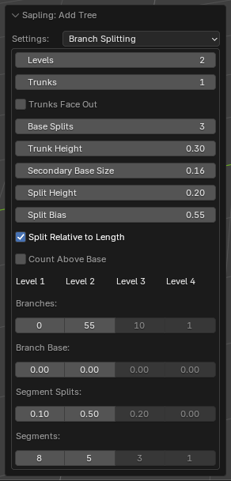
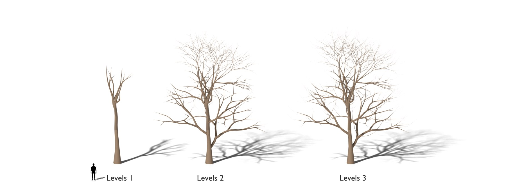
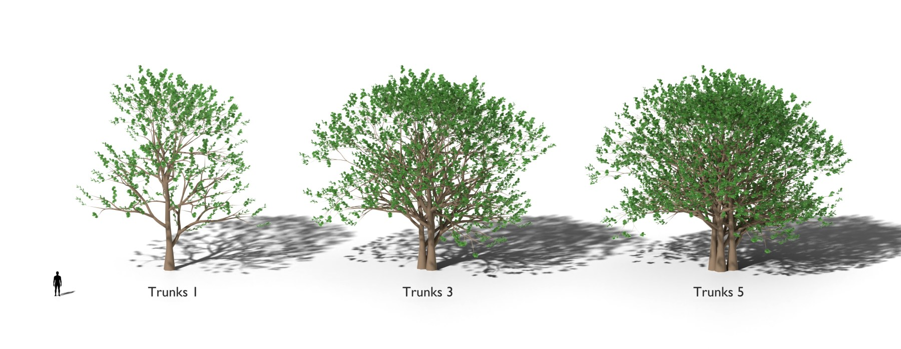
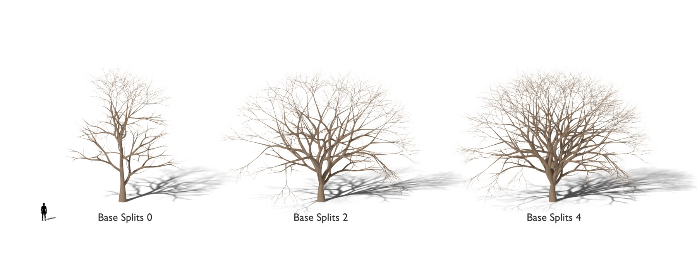
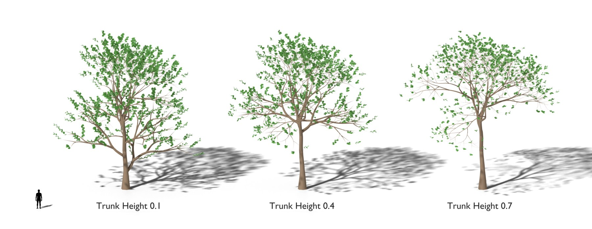
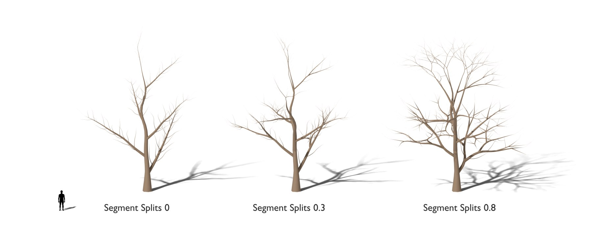

# Branch Splitting

The levels, the trunks, the splits and the number of branches. [Back to the manual](index.md)

| Setting | Default | Range | What it does |
| --- | --- | --- | --- |
| Levels | 3 | 1 to 6 | The number of branch levels. Level 1 is the trunk. |
| Trunks | 1 | 1 and more | The number of trunks that grow from one root, as a clump (bamboo). |
| Trunks Face Out | off | | Only with *Trunks* above 1: each further trunk curves away from the centre of the clump. Off: each trunk curves in a random direction. |
| Base Splits | 0 | 0 and more | The trunk splits into this number of parts at the base of the crown. |
| Trunk Height | 0.4 | 0 to 1 | The part of the trunk with no branches, from the ground. |
| Secondary Base Size | 0.25 | 0 to 1 | The bare base of the branches, as a part of the bare base of their parent. |
| Split Height | 0.2 | 0 to 1 | The part of the tree height with no splits. |
| Split Bias | 0 | | Puts more splits near the top or near the base of the tree. |
| Split Relative to Length | off | | Splits in proportion to the length of the branch. |
| Count Above Base | off | | The branch count is for the part of a stem above its bare base. Off: for the whole stem. |
| Branches (per level) | 50, 30, 10, 10 | 0 and more | The number of branches that grow on each branch of the level before. |
| Branch Base (per level) | 0 | 0 to 0.95 | The bare part at the start of the stems of the level, where nothing grows. 0: the base of the level before times *Secondary Base Size*. |
| Segment Splits (per level) | 0 | 0 and more | The number of splits per segment of a stem of the level. 0.5 splits about every second segment. |
| Segments (per level) | 3, 5, 3, 1 | 1 and more | The number of segments of each stem of the level. More segments make smoother curves. |

The angles of the splits are on the [Branch Angles](branch-angles.md) page.
