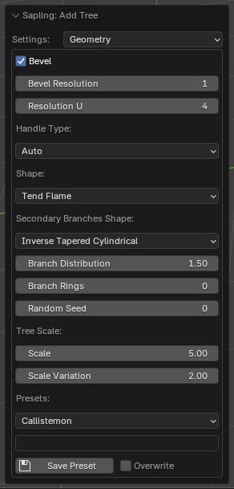
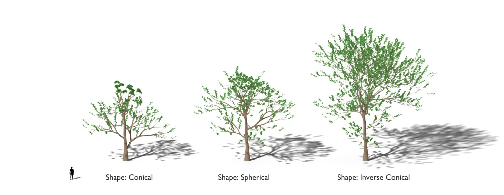
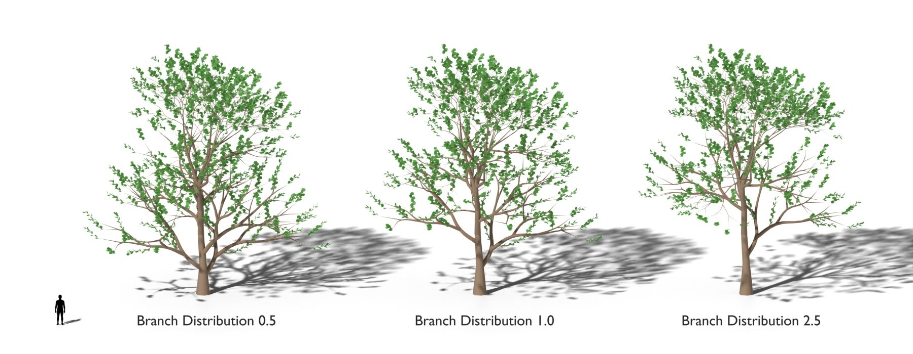
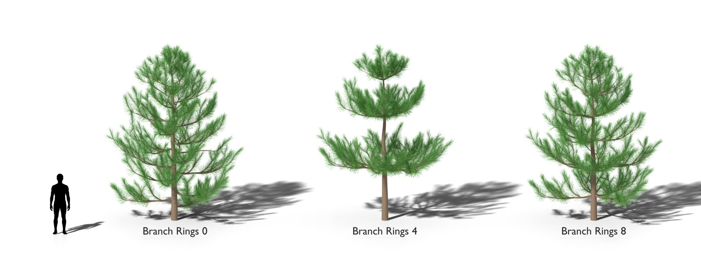

# Geometry

The bevel and the resolution of the branches, the crown shape, the scale, the random seed and the presets.
[Back to the manual](index.md)

| Setting | Default | Range | What it does |
| --- | --- | --- | --- |
| Bevel | off | | Gives the branches their thickness. Off: the branches are lines. |
| Bevel Resolution | 0 | 0 to 32 | The resolution of the bevel. Higher values make rounder branches. |
| Resolution U | 4 | 1 and more | The smoothness of the branches along their length. |
| Handle Type | Auto | Auto, Vector | *Auto* makes smooth branches. *Vector* makes straight segments between the points. |
| Shape | Tend Flame | | The outline of the crown: how long the branches are along the trunk. |
| Custom Shape | 0.5, 1.0, 0.3, 0.5 | 0.01 to 1 | Only with *Shape* *Custom Shape*: the branch length at the base, at the middle, the height of the middle, and at the top. |
| Secondary Branches Shape | Tapered Cylindrical | | The outline that the branches of level 3 and above follow along their parent. |
| Branch Distribution | 1.0 | 0.1 and more | Above 1 puts more branches near the top of the trunk; below 1, near the base. |
| Branch Rings | 0 | 0 and more | Above 0: the branches grow in that number of rings (whorls) at most, as on a pine. |
| Random Seed | 0 | | Another seed gives another tree of the same kind. |
| Scale | 13 | 0 and more | The height of the tree in metres. |
| Scale Variation | 3 | | A random change of the height, up to this many metres. *Scale* less *Scale Variation* must be above 0. |

## Presets

- **Presets** loads a built-in preset or one of your presets. The settings of all pages change to the preset.
- **Save Preset** saves the settings with the name in the field above it. Your presets are in the user folder of the
  extension and stay after an update.
- **Overwrite** lets *Save Preset* replace a preset of the same name.

The extension refuses a preset name that is empty, that has a path in it, or that is the name of a built-in preset.

## Notes

- The same settings and the same seed always give the same tree.
- A *Scale* and a *Scale Variation* that can give a height of 0 or less stop the tree with a message that names both.
