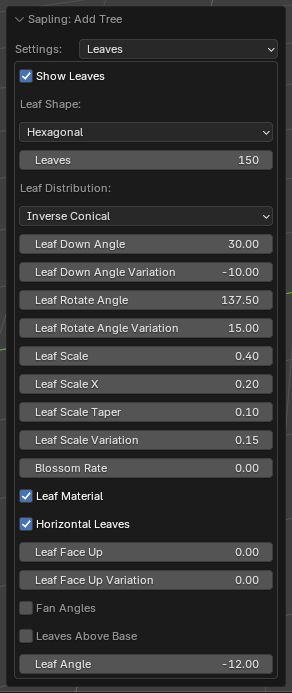
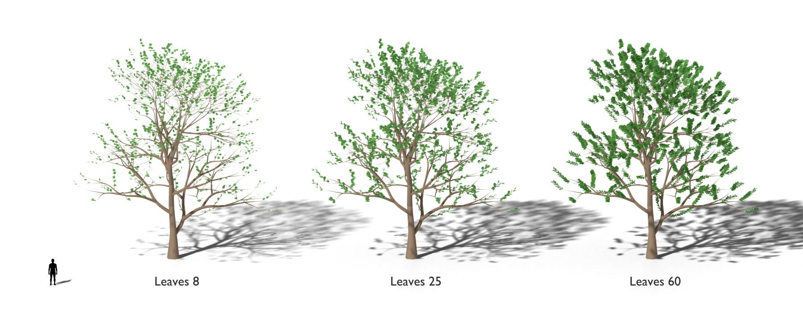
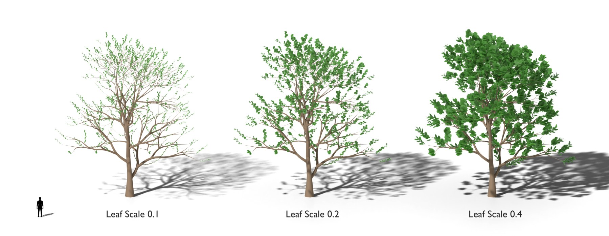
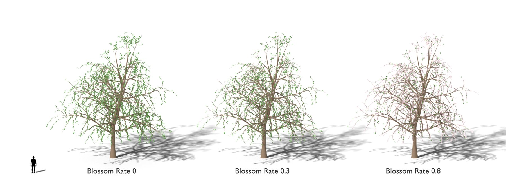

# Leaves

The leaves and the blossoms. [Back to the manual](index.md)

## The leaves

| Setting | Default | Range | What it does |
| --- | --- | --- | --- |
| Show Leaves | off | | Grows the leaves. |
| Leaf Shape | Hexagonal | Hexagonal, Rectangular, Instance Faces, Instance Points | *Hexagonal* and *Rectangular* make mesh leaves. *Rectangular* suits an image texture. *Instance Faces* and *Instance Points* put your *Leaf Object* on each leaf. |
| Leaf Object | | | Only with *Instance Faces* or *Instance Points*: the object that each leaf is. |
| Leaves | 25 | | The number of leaves on each branch of the last level. A negative value grows a fan of leaves from the tip of the branch (palms). |
| Leaf Distribution | Inverse Conical | | How the leaves spread along the branches. |
| Leaf Down Angle | 45 | | The angle between a leaf and its branch, in degrees. |
| Leaf Down Angle Variation | 10 | | A positive value makes the angle smaller toward the end of the branch. A negative value changes it at random. |
| Leaf Rotate Angle | 137.5 | | The angle round the branch from one leaf to the next. A negative value puts the leaves on alternating sides. |
| Leaf Rotate Angle Variation | 0 | | A random change of *Leaf Rotate Angle*. |
| Leaf Scale | 0.17 | 0 and more | The size of a leaf, in metres. |
| Leaf Scale X | 1.0 | 0 and more | The width of a leaf, as a part of its length. |
| Leaf Scale Taper | 0 | -1 to 1 | Makes the leaves smaller toward the tip (above 0) or toward the base (below 0) of the branch. |
| Leaf Scale Variation | 0 | 0 to 1 | A random change of the leaf size. |
| Leaf Material | on | | Gives mesh leaves the *Sapling Leaf* material and blossoms the *Sapling Blossom* material. Light goes through them, as through real leaves and petals. |
| Horizontal Leaves | on | | Turns the leaves of a stem to one side of the stem. Off: the leaves face all round the stem. |
| Leaf Face Up | 0 | 0 to 1 | Turns each leaf's face toward the sky by this part. 1 makes every leaf lie flat, as a foliage pad. |
| Leaf Face Up Variation | 0 | 0 to 90 | After *Leaf Face Up*, tilts each leaf by a random angle up to this value. |
| Fan Angles | off | | Fans of leaves (a negative *Leaves*) use *Leaf Down Angle* (a shallow cup) and *Leaf Rotate Angle Variation*. Off: flat, even fans. |
| Leaves Above Base | off | | Keeps the leaves off the bare base of their stems. Off: the leaves grow along the whole stem. |
| Leaf Angle | 0 | | Turns each leaf blade about its width axis, in degrees. |

## The blossoms

| Setting | Default | Range | What it does |
| --- | --- | --- | --- |
| Blossom Rate | 0 | 0 to 1 | The part of the leaf positions that grow a blossom, not a leaf. 0 gives no blossoms; 1 gives only blossoms. |
| Blossom Shape | Cherry | Cherry, Orange, Magnolia | *Cherry*: five round petals. *Orange*: five narrow petals that bend back. *Magnolia*: eight petals in a deep cup. Only with *Blossom Rate* above 0. |
| Blossom Scale | 0.1 | 0 and more | The diameter of a blossom, in metres. Only with *Blossom Rate* above 0. |

The blossoms are a separate object, *blossoms*. They move with the leaves in the wind.

## Notes

- *Instance Faces* or *Instance Points* without a *Leaf Object* stops the tree with a message.
- The extension makes each material one time and uses it again, so your changes to the materials stay.
