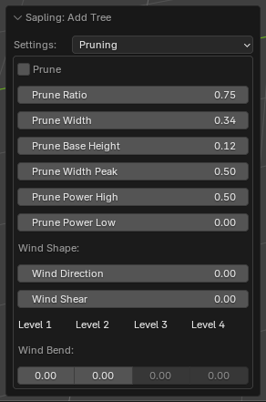
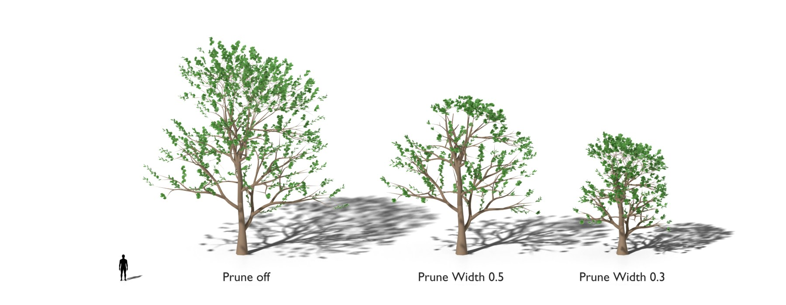

# Pruning

The pruning envelope, and the shape that the wind gives the crown. [Back to the manual](index.md)

## The pruning envelope

With *Prune*, the extension cuts the branches back to an envelope: a shape round the trunk, like the outline of a
clipped hedge.

| Setting | Default | Range | What it does |
| --- | --- | --- | --- |
| Prune | off | | Cuts the branches back to the envelope. |
| Prune Ratio | 1.0 | 0 to 1 | How much of the cut is done. With 1, a branch that keeps less than 15 % of its length is removed, with its leaves. |
| Prune Width | 0.4 | 0 and more | The width of the envelope, as a part of the tree height. |
| Prune Base Height | 0.3 | 0 to 1 | The height of the base of the envelope. It is at least the *Trunk Height*. |
| Prune Width Peak | 0.6 | 0 and more | The height where the envelope is widest, as a part of its height. |
| Prune Power High | 0.5 | | The shape of the envelope above its widest point. |
| Prune Power Low | 0.001 | | The shape of the envelope below its widest point. |

The envelope is hidden after generation. To see it, show the *envelope* object in *Object Properties > Visibility*.

## The wind shape

These settings give the crown the shape of a tree that a constant wind has formed. They do not animate the tree: the
wind animation is on the [Animation](animation.md) page.

| Setting | Default | Range | What it does |
| --- | --- | --- | --- |
| Wind Direction | 0 | 0 to 360 | The direction that the wind blows toward, round the trunk. 0 is toward -Y, 90 is toward +X. Only with *Wind Shear* or *Wind Bend* above 0. |
| Wind Shear | 0 | 0 to 0.9 | Cuts the envelope back on the windward side and lets it reach further downwind. Only with *Prune*. |
| Wind Bend (per level) | 0 | 0 to 1 | Turns the branches of the level downwind, as *Outward Attraction* turns them out. |

## Notes

- *Prune* with *Prune Base Height* and *Trunk Height* both at 1 stops the tree with a message: the envelope would have
  no height.
