# The built-in presets

Every built-in preset of Sapling Tree Gen, with its default seed. The black figure is 1.8 m tall. This
page and its pictures are made by `tools/render_presets.py`; the pictures are CC0.

## Acer

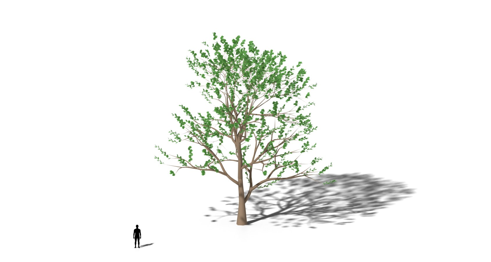

A maple with a rounded, open crown of broad leaves. From tree-gen.

Height 14.2 m, width 18.6 m. Preset name: `acer`. Generated in 0.06 s.

## Apple

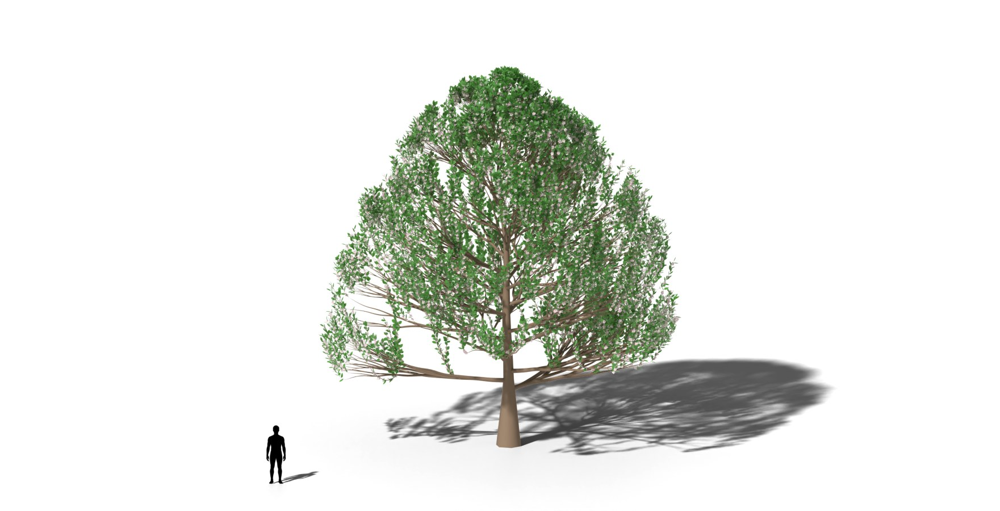

An apple tree with a low, wide crown, leaves and white blossoms. From tree-gen.

Height 11.8 m, width 11.2 m. Preset name: `apple`. Generated in 0.35 s.

## Balsam fir

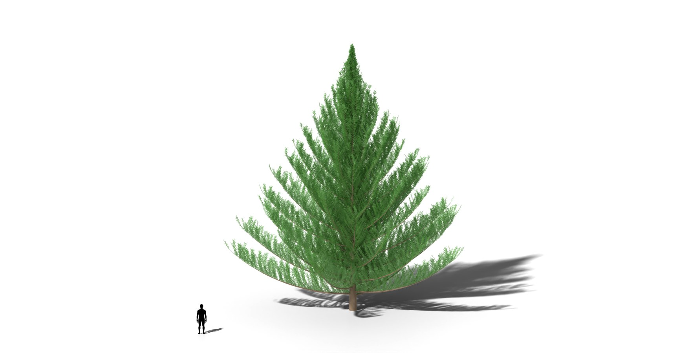

A balsam fir: a narrow, pointed conifer with dense, level branches. From tree-gen.

Height 16.1 m, width 14.2 m. Preset name: `balsam_fir`. Generated in 2.24 s.

## Bamboo

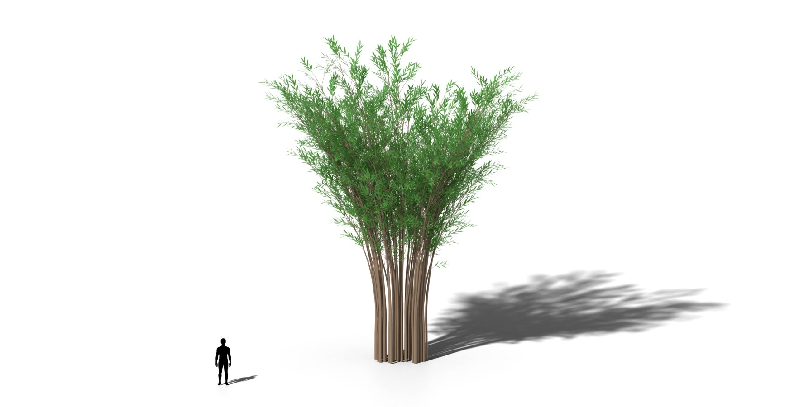

A clump of bamboo: many thin, straight stems with narrow leaves at the top. From tree-gen.

Height 11.8 m, width 10.7 m. Preset name: `bamboo`. Generated in 0.22 s.

## Black oak

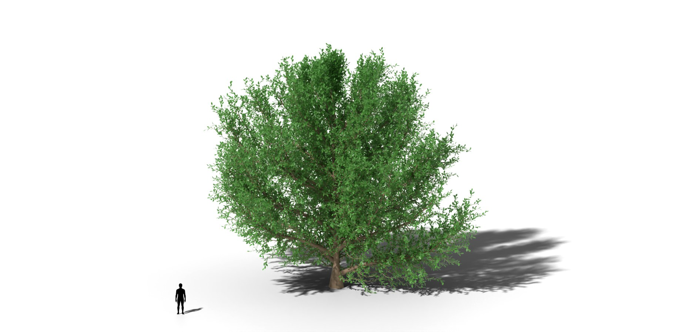

A black oak with a wide, irregular crown on crooked limbs. From tree-gen.

Height 14.1 m, width 16.4 m. Preset name: `black_oak`. Generated in 0.62 s.

## Black tupelo

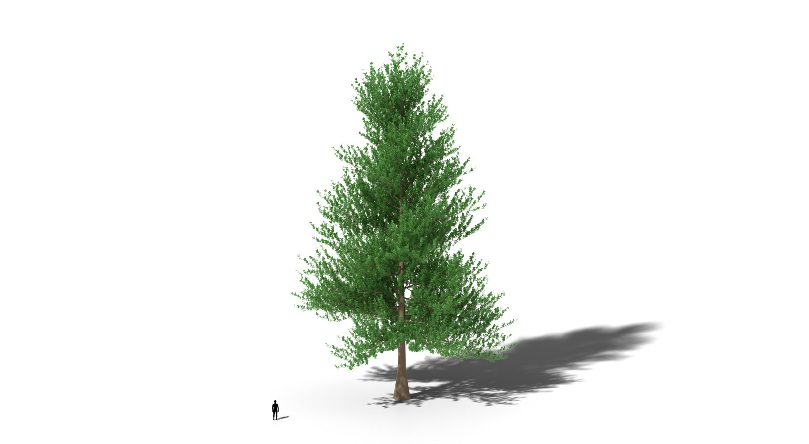

A black tupelo: a tall, straight trunk with short, level branches and a narrow crown. From tree-gen.

Height 31.6 m, width 20.0 m. Preset name: `black_tupelo`. Generated in 1.19 s.

## California sagebrush

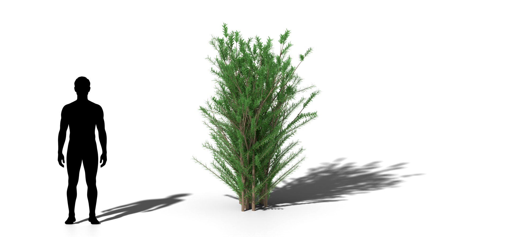

A California sagebrush: a coastal shrub of many slender, upright stems with fine foliage.

Height 2.2 m, width 1.8 m. Preset name: `california_sagebrush`. Generated in 0.40 s.

## Callistemon

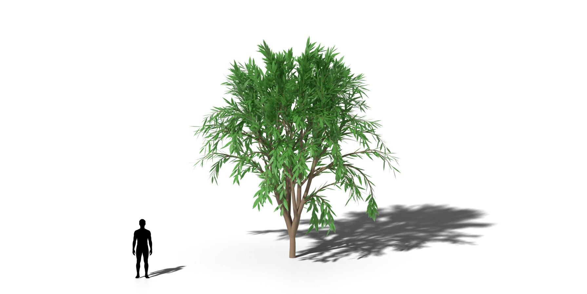

A bottlebrush (Callistemon): a small tree with a rounded crown of narrow leaves.

Height 6.7 m, width 6.4 m. Preset name: `callistemon`. Generated in 0.09 s.

## Cambridge oak

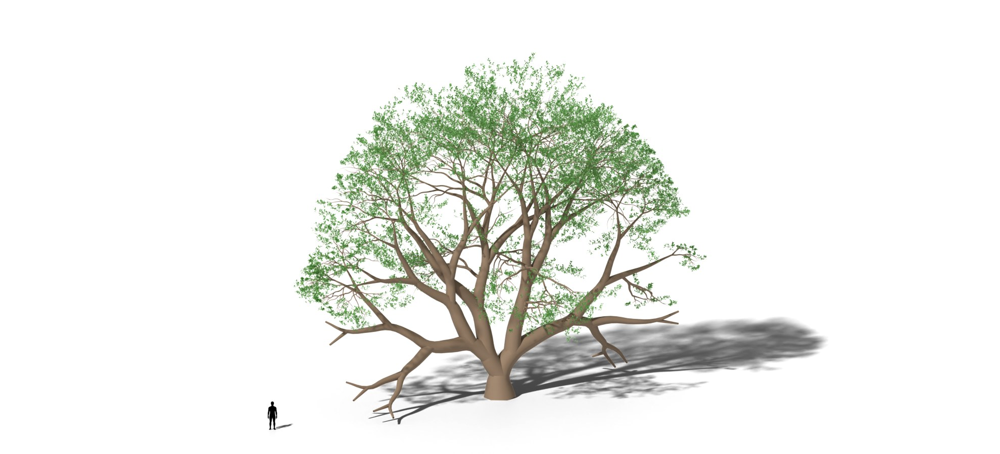

A large oak with a wide, dense crown on heavy limbs. From tree-gen.

Height 21.9 m, width 25.8 m. Preset name: `cambridge_oak`. Generated in 1.57 s.

## Coast live oak

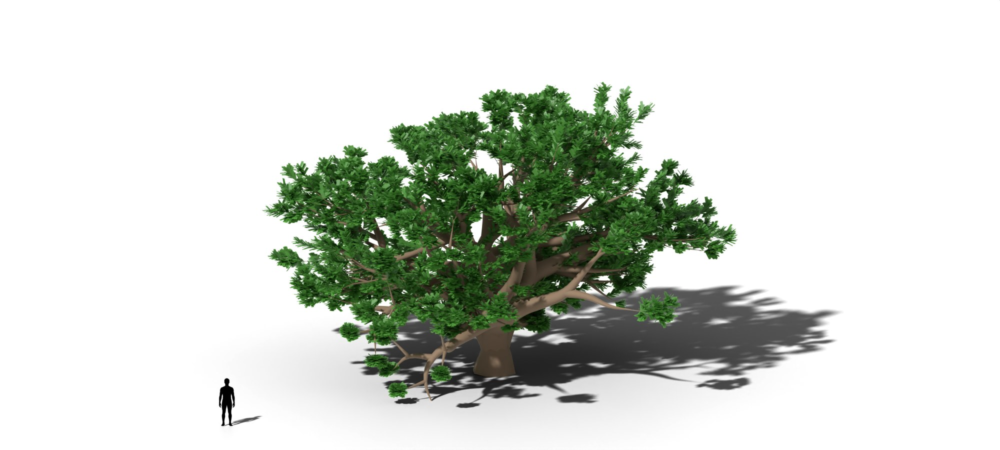

A coast live oak: a low, wide evergreen oak with crooked limbs and a dense, rounded crown.

Height 12.0 m, width 18.5 m. Preset name: `coast_live_oak`. Generated in 1.46 s.

## Coyote brush

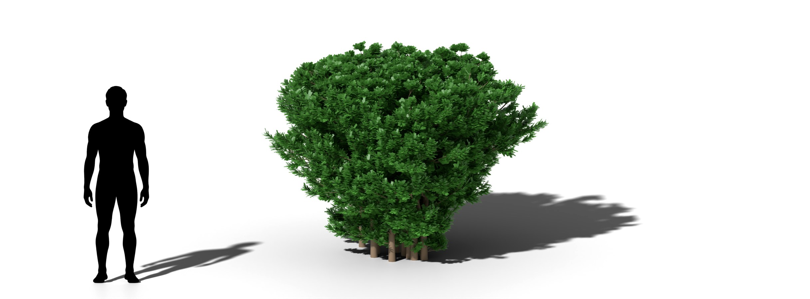

A coyote brush: a dense, rounded coastal shrub with small leaves.

Height 1.9 m, width 2.6 m. Preset name: `coyote_brush`. Generated in 2.66 s.

## Douglas fir

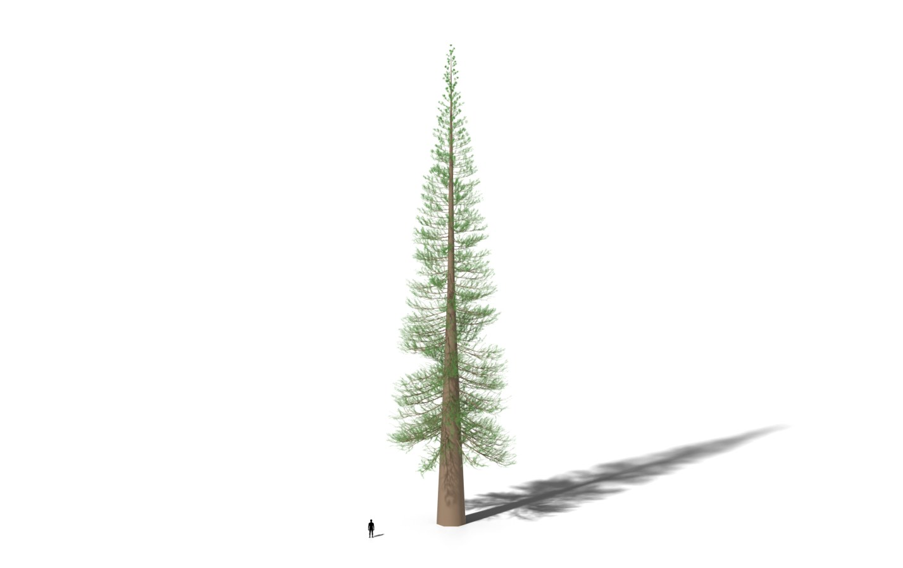

A Douglas fir: a very tall, narrow conifer with a straight trunk. From tree-gen.

Height 47.4 m, width 12.9 m. Preset name: `douglas_fir`. Generated in 1.95 s.

## European larch

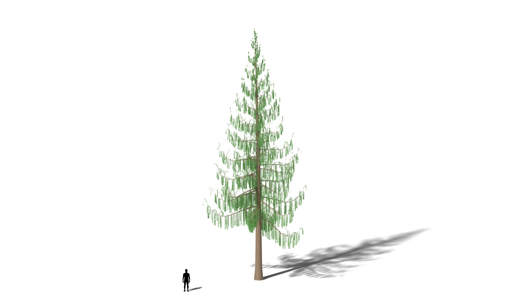

A European larch: a conical conifer with level branches and fine needles. From tree-gen.

Height 20.2 m, width 9.1 m. Preset name: `european_larch`. Generated in 1.41 s.

## Fan palm

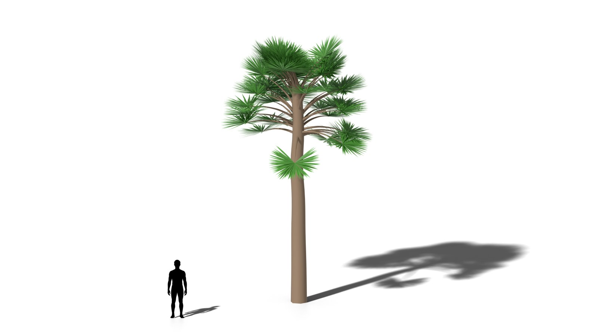

A fan palm: a tall, bare trunk with a crown of fan-shaped leaves. From tree-gen.

Height 8.3 m, width 4.7 m. Preset name: `fan_palm`. Generated in 0.05 s.

## Hill cherry

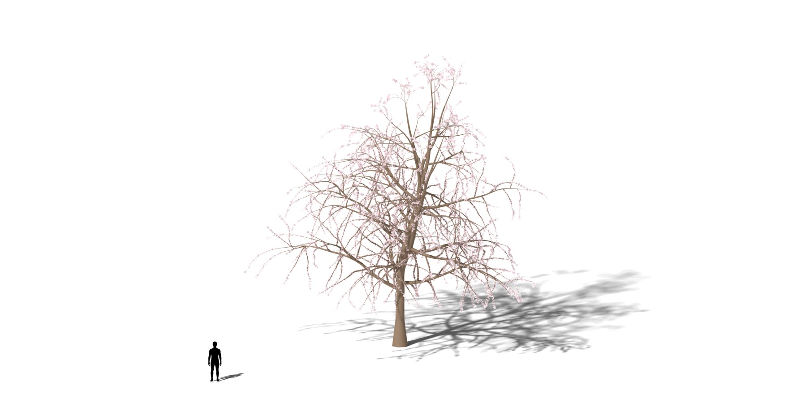

A hill cherry in blossom: a wide crown with many flowers. From tree-gen.

Height 13.0 m, width 15.2 m. Preset name: `hill_cherry`. Generated in 0.37 s.

## Japanese maple

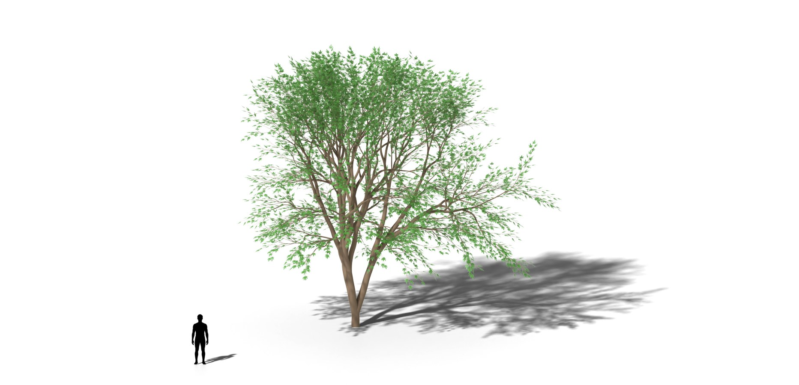

A Japanese maple: a small tree with a wide crown of fine leaves.

Height 10.0 m, width 11.4 m. Preset name: `japanese_maple`. Generated in 0.48 s.

## Lombardy poplar

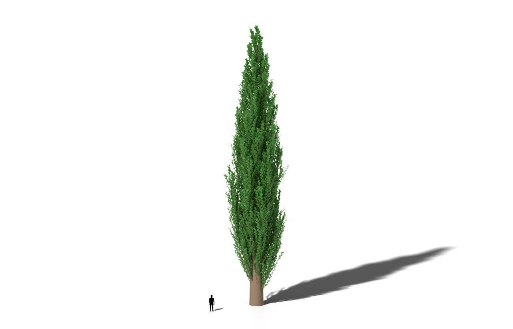

A Lombardy poplar: a tall, narrow column of upright branches. From tree-gen.

Height 30.7 m, width 7.0 m. Preset name: `lombardy_poplar`. Generated in 0.33 s.

## Monterey cypress grove

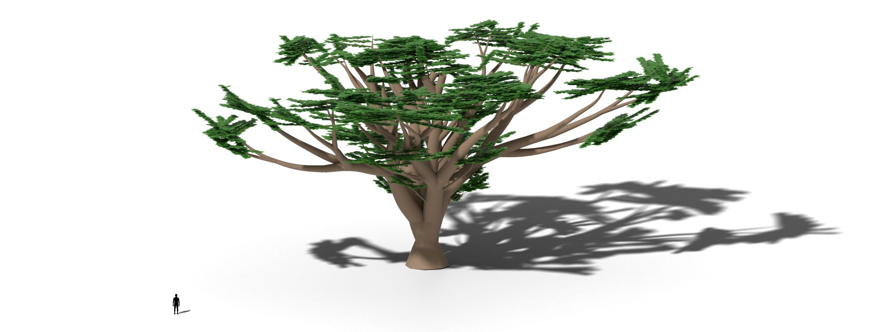

A Monterey cypress in a sheltered grove: heavy limbs spread wide from a low fork and carry flat layers of foliage.

Height 18.2 m, width 44.1 m. Preset name: `monterey_cypress_grove`. Generated in 0.60 s.

## Monterey cypress lone

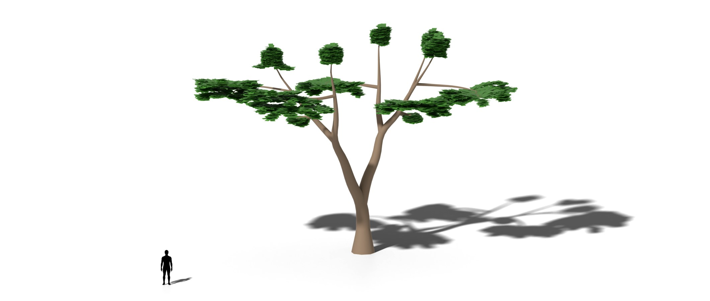

A lone Monterey cypress: a forked trunk with level limbs that carry flat layers of foliage.

Height 11.4 m, width 16.5 m. Preset name: `monterey_cypress_lone`. Generated in 0.41 s.

## Monterey cypress sheared

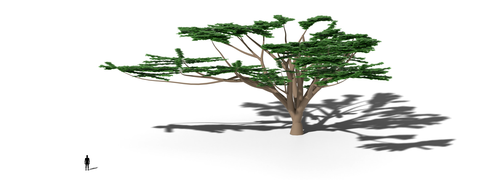

A Monterey cypress that the sea wind keeps low: a wide, flat crown in layers of foliage.

Height 12.2 m, width 33.9 m. Preset name: `monterey_cypress_sheared`. Generated in 0.45 s.

## Monterey pine

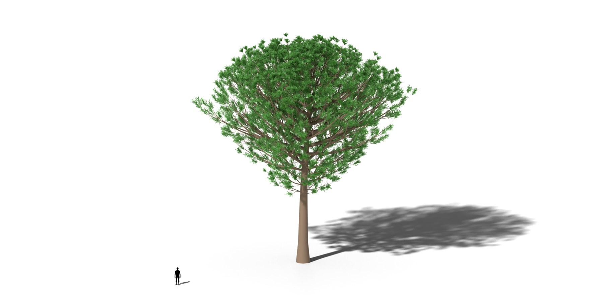

A Monterey pine: a tall, straight trunk and a rounded crown of upturned limbs with tufts of needles.

Height 23.2 m, width 23.0 m. Preset name: `monterey_pine`. Generated in 1.54 s.

## Palm

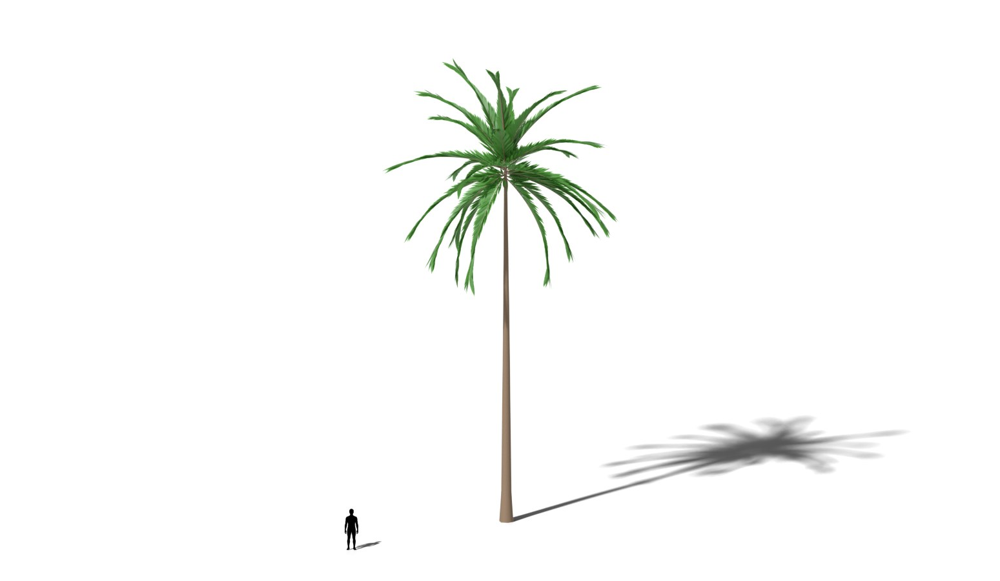

A palm: a tall, slender trunk with a crown of long fronds. From tree-gen.

Height 20.6 m, width 10.2 m. Preset name: `palm`. Generated in 0.08 s.

## Quaking aspen

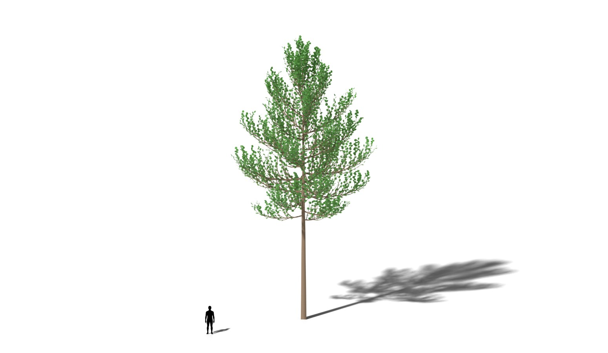

A quaking aspen: a slender, straight trunk with a narrow crown of small leaves.

Height 18.1 m, width 9.6 m. Preset name: `quaking_aspen`. Generated in 0.11 s.

## Quaking aspen treegen

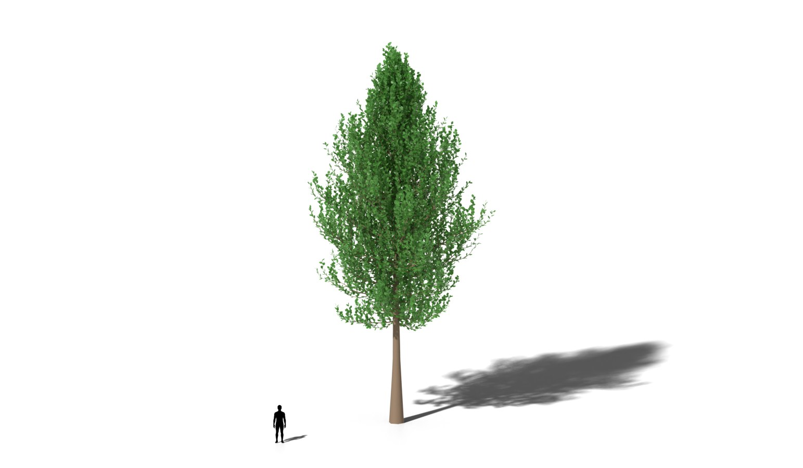

A quaking aspen from tree-gen: a slender trunk with a narrow, open crown.

Height 18.0 m, width 8.9 m. Preset name: `quaking_aspen_treegen`. Generated in 0.26 s.

## Sassafras

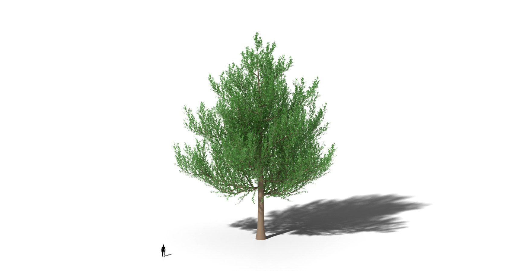

A sassafras: a tall tree with a wide crown of level limbs. From tree-gen.

Height 31.1 m, width 24.9 m. Preset name: `sassafras`. Generated in 0.99 s.

## Silver birch

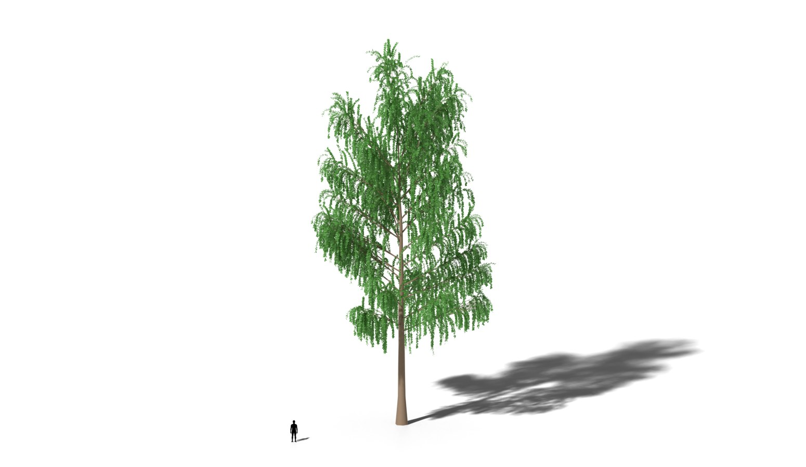

A silver birch: a tall, light tree with an open crown of small, heart-shaped leaves. From tree-gen.

Height 31.6 m, width 15.1 m. Preset name: `silver_birch`. Generated in 0.94 s.

## Small maple

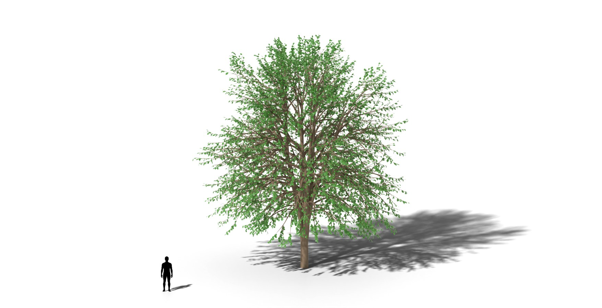

A small maple with a rounded crown.

Height 11.8 m, width 11.2 m. Preset name: `small_maple`. Generated in 0.18 s.

## Small pine

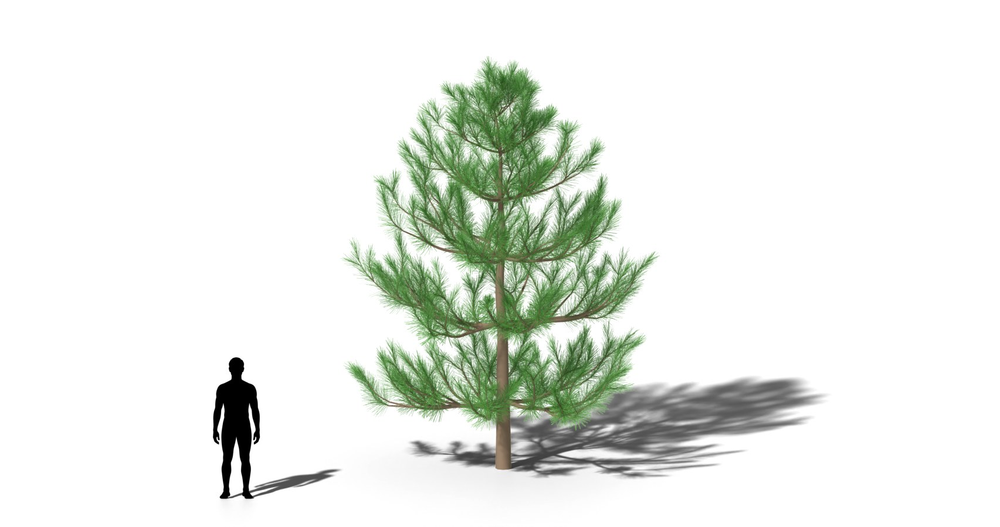

A small pine: a young conifer with level branches and long needles.

Height 5.2 m, width 4.0 m. Preset name: `small_pine`. Generated in 0.29 s.

## Sphere tree

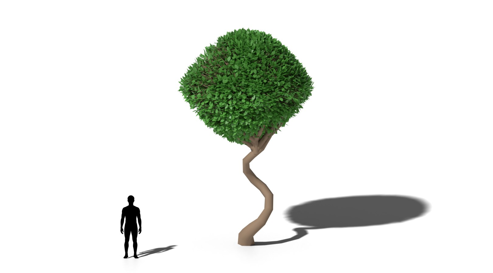

A topiary tree: a curved, bare stem with a ball of foliage at the top. From tree-gen.

Height 6.3 m, width 3.9 m. Preset name: `sphere_tree`. Generated in 0.43 s.

## Weeping willow

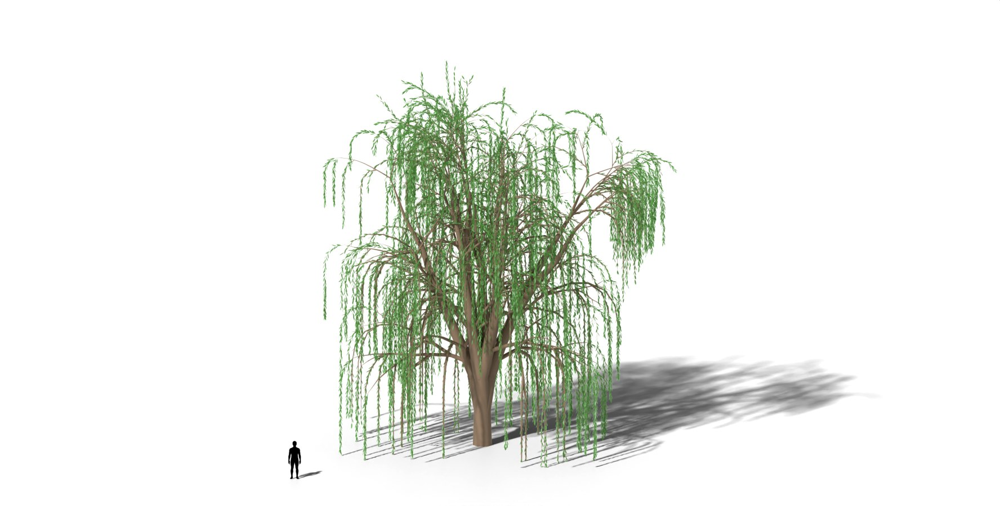

A weeping willow: long, thin branches hang down from a wide crown.

Height 22.1 m, width 16.5 m. Preset name: `weeping_willow`. Generated in 0.27 s.

## White birch

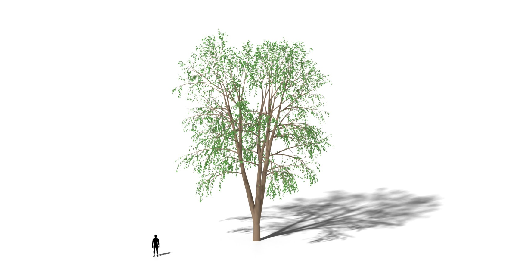

A white birch with an open crown of small leaves.

Height 17.0 m, width 13.5 m. Preset name: `white_birch`. Generated in 0.15 s.

## Willow

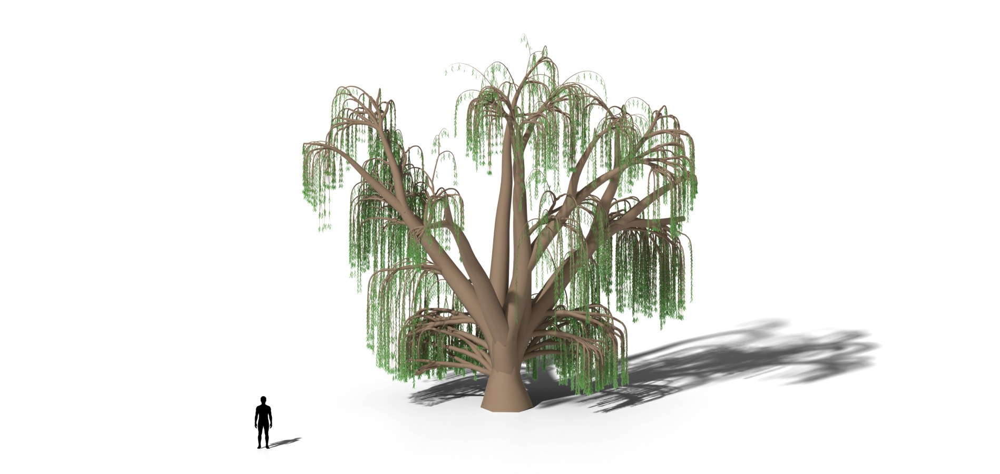

A weeping willow from tree-gen: a wide crown of hanging branches.

Height 12.2 m, width 13.3 m. Preset name: `willow`. Generated in 1.49 s.
